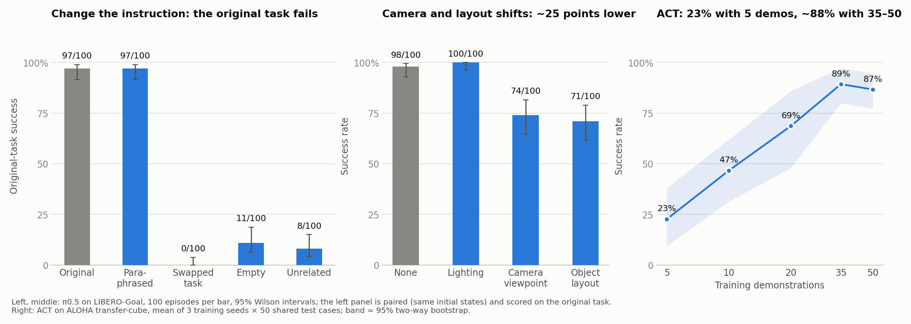
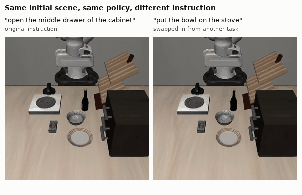
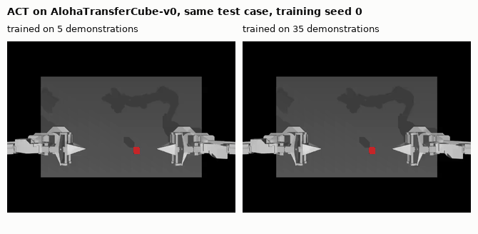
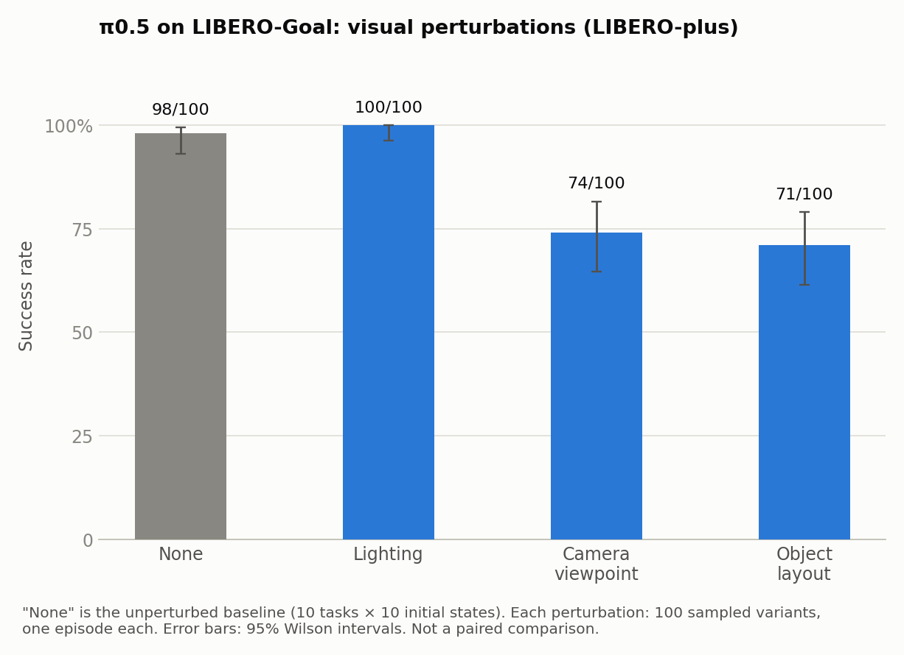
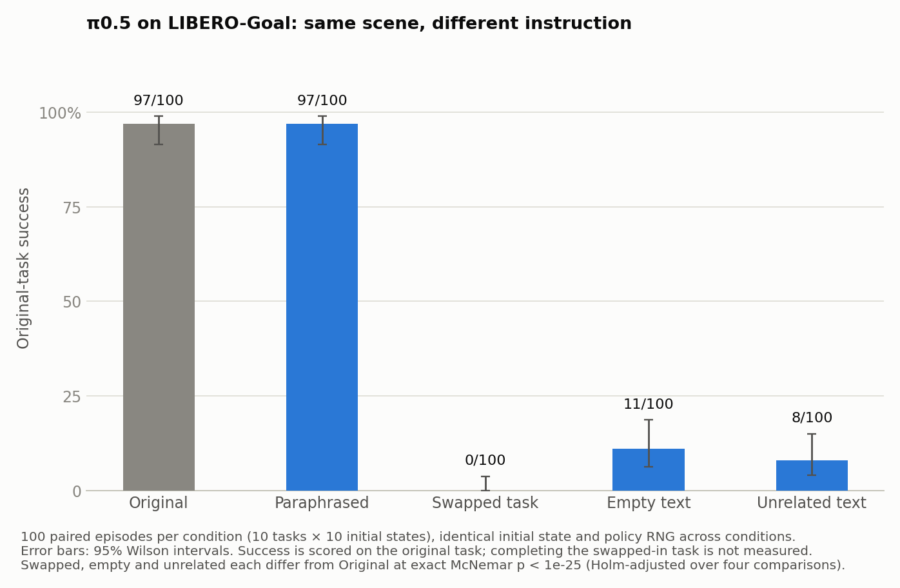
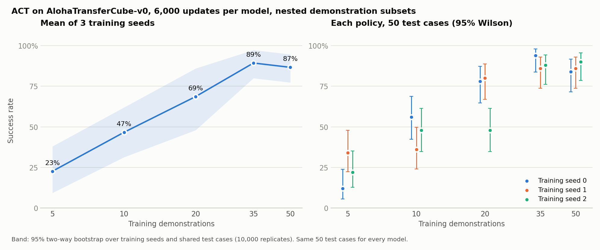

# VLA evaluation in simulation: instruction sensitivity, visual robustness and data scaling

**π0.5 really does use the instruction.** On LIBERO-Goal it completes 97/100 episodes with the original instruction and 97/100 with a paraphrase. With another task's instruction, it completes 0/100 (exact McNemar p ≈ 10⁻²⁹ against the same initial states). Camera-viewpoint and object-layout perturbations cost about 25 points, while lighting changes cost nothing. In a separate experiment, ACT on an ALOHA transfer-cube task goes from 23% success with 5 demonstrations to about 88% with 35–50.



```bash
pip install -r requirements.txt && make check plots   # recompute every number and figure from the committed episode records, no GPU needed
```

| Same scene and policy, different instruction | ACT with 5 vs 35 demonstrations |
|---|---|
|  |  |

Every success rate below comes with a 95% interval, every paired comparison with an exact test. Each experiment folder keeps its code as it was run, the frozen configuration, the protocol notes and the per-episode results.

## What we tested

| # | Question | Setup | Episodes |
|---|---|---|---|
| 1 | Does our pipeline reproduce the published π0.5 result? | `lerobot/pi05_libero_finetuned_v044` on LIBERO-Goal, 10 tasks × 10 initial states | 100 |
| 2 | How much do lighting, camera and layout changes hurt? (visual robustness) | Same checkpoint on LIBERO-plus Goal variants, 100 sampled variants per perturbation | 300 |
| 3 | Does the policy read the instruction, or act from the scene alone? (language grounding) | Same checkpoint, LIBERO-Goal, 5 instruction conditions on identical paired initial states | 500 |
| 4 | How does success scale with the number of demonstrations? | ACT trained from scratch on 5/10/20/35/50 scripted demos of `AlohaTransferCube-v0`, 3 training seeds each | 750 |

Experiments 1–3 share one model checkpoint, one LeRobot commit and one rollout setting. Experiment 3 adds a paired design: for each (task, initial state) pair, all five conditions start from the same simulator state and the same policy random-number state. The only difference between conditions is the instruction string.

## Results

### 1. Baseline reproduction

| Suite | Ours | Wilson 95% CI | Published |
|---|---|---|---|
| LIBERO-Goal | **98/100 (98.0%)** | 93.0–99.4% | 98.0% |

All ten tasks reached 9/10 or 10/10. Only the Goal suite and one evaluation seed were run, because Goal is the suite the later experiments use. Details: [experiments/01_baseline](experiments/01_baseline/).

### 2. Visual perturbations (LIBERO-plus)



| Perturbation | Success | Wilson 95% CI | Difference from 98% baseline |
|---|---|---|---|
| Lighting | 100/100 | 96.3–100% | +2 pp |
| Camera viewpoint | 74/100 | 64.6–81.6% | −24 pp |
| Object layout (moved objects and distractors) | 71/100 | 61.5–79.0% | −27 pp |

The policy is unaffected by lighting changes, but loses roughly a quarter of its successes when the camera moves or objects are rearranged. These are 100 variants sampled per perturbation, one episode each. The baseline uses a different task mix, so this is not a paired comparison. Details: [experiments/02_libero_plus](experiments/02_libero_plus/).

### 3. Instruction interventions



| Instruction given | Original-task success | Wilson 95% CI | Paired vs. original: lost / gained | Exact McNemar p (Holm) |
|---|---|---|---|---|
| Original | 97/100 | 91.5–99.0% | — | — |
| Paraphrase (from LIBERO-PRO) | 97/100 | 91.5–99.0% | 1 / 1 | 1.0 |
| Another task's instruction | **0/100** | 0–3.7% | 97 / 0 | 5.0 × 10⁻²⁹ |
| Empty task text | 11/100 | 6.3–18.6% | 86 / 0 | 5.2 × 10⁻²⁶ |
| Unrelated sentence | 8/100 | 4.1–15.0% | 89 / 0 | 9.7 × 10⁻²⁷ |

π0.5 tolerates rewording but does not complete the original task when the instruction names a different one. In the example above it opens the drawer when told to, and moves the bowl to the stove when given that instruction, starting from an identical scene. With no usable instruction (empty or unrelated text), it still succeeds about 10% of the time. Success is scored only on the original task; whether it completed the swapped-in task was not measured. Details: [experiments/03_instruction_swap](experiments/03_instruction_swap/).

### 4. Demonstrations vs. success (ACT)



| Demonstrations | Seed 0 | Seed 1 | Seed 2 | Mean | Bootstrap 95% CI |
|---|---|---|---|---|---|
| 5 | 12% | 34% | 22% | 22.7% | 9.3–38.0% |
| 10 | 56% | 36% | 48% | 46.7% | 31.3–62.0% |
| 20 | 78% | 80% | 48% | 68.7% | 48.0–86.0% |
| 35 | 94% | 86% | 88% | 89.3% | 80.0–97.3% |
| 50 | 84% | 86% | 90% | 86.7% | 77.3–94.7% |

Success rises steeply up to 35 demonstrations, with no further gain from 35 to 50 at this training budget. Variation between training seeds is large below 35 demonstrations: at 20 demos, one seed reached 48% while the other two reached about 80%. With only three seeds this is a description, not an estimate of where the curve plateaus. Details: [experiments/04_data_scaling](experiments/04_data_scaling/).

## Reproduce

### From the committed results (seconds, no GPU)

```bash
pip install -r requirements.txt
make check   # recompute all success counts, Wilson intervals, McNemar/Holm p-values and the bootstrap from episodes.jsonl
make plots   # redraw figures/*.png from the same records
```

`make check` compares each recomputed value with the committed `summary.csv` files and fails on any mismatch.

### Rerunning the experiments (cloud GPUs, costs money)

All rollouts and training ran on [Modal](https://modal.com) from pinned container images. You need a Modal account and a Modal secret named `knightec-huggingface` that holds an `HF_TOKEN`. Then:

```bash
make smoke      # 1: two LIBERO-Object episodes, checks rendering and model loading (A100)
make baseline   # 1: 100 LIBERO-Goal episodes, ~20 A100-minutes
make plus       # 2: 3 × 100 LIBERO-plus variants, ~76 A100-minutes
```

Run `make baseline` before `make plus`: experiment 2 reuses the model cache that the baseline creates. Experiment 3 (~172 A100-minutes) and experiment 4 (~174 A10-minutes for training and evaluation) reuse state from our own runs: the baseline run's name, a budget ledger and a cached data image. Their READMEs list the exact commands and the edits a rerun needs. The make targets wrap the commands that produced the committed results, but they have not been rerun since the repository was assembled. Rollout videos, initial-state images, logs and model checkpoints are not in git (about 280 MB in total).

### Pinned versions

| Component | Version |
|---|---|
| LeRobot | `72e1d9e5e76ee719bacfc78bc34d817bee5fb521` |
| π0.5 checkpoint | `lerobot/pi05_libero_finetuned_v044` @ `7152f13e34c6c115d808aea0e5d08aca74eac14b` |
| LIBERO-plus | `sylvestf/LIBERO-plus` @ `4976dc30028e805ff8094b55501d532c48fec182` |
| LIBERO-PRO (paraphrases only) | `Zxy-MLlab/LIBERO-PRO` @ `eafdb809426b13153aa1e4c42d6601844217dfec` |
| ALOHA dataset | `lerobot/aloha_sim_transfer_cube_scripted` @ `c5467ba9059e4c65f27775ced212076980a173fb` |
| Python, PyTorch | 3.12, torch 2.11.0, torchvision 0.26.0; gym-aloha 0.1.5 |
| GPUs | NVIDIA A100-SXM4-40GB (π0.5), NVIDIA A10 (ACT) |

The full package list of every run is in its `packages.txt` or run manifest.

## Limitations

- **Simulation only.** None of this has been run on a real robot. Scripted ALOHA demonstrations are cleaner than human teleoperation.
- **One model per question.** Experiments 1–3 test one π0.5 checkpoint, fine-tuned on LIBERO. Experiment 4 tests ACT, which does not use language.
- **Single evaluation seed** for experiments 1–3. The baseline covers only the Goal suite, not all four LIBERO suites.
- **Intervals are per-episode.** Wilson and McNemar treat episodes as independent; episodes from the same task are likely correlated, so the true uncertainty is somewhat larger.
- **Experiment 2 is sampled.** It uses 100 of the LIBERO-plus variants per perturbation, one episode each. Task mixes differ between perturbations, and "object layout" combines moved objects with added distractors. Prompts were normalized to the base-task instruction (see the experiment README).
- **Experiment 3 scores only the original task.** "Empty task text" keeps π0.5's prompt template and state tokens. Changing the text also changes token positions, so this measures sensitivity to the task text rather than isolating semantic understanding.
- **Experiment 4 uses a fixed budget** of 6,000 updates for every data size, three training seeds and one nested chain of demonstration subsets. Audit replays of the same checkpoints changed 3 of 750 outcomes (reported separately; primary results are the first evaluation).

Each experiment README lists every protocol deviation and how it was handled.


## Acknowledgements

Built on [LeRobot](https://github.com/huggingface/lerobot) (Apache-2.0), [LIBERO](https://github.com/Lifelong-Robot-Learning/LIBERO), [LIBERO-plus](https://github.com/sylvestf/LIBERO-plus), [LIBERO-PRO](https://github.com/Zxy-MLlab/LIBERO-PRO) (MIT) and [gym-aloha](https://github.com/huggingface/gym-aloha). The custom rollout loop in experiment 3 follows LeRobot's rollout at the pinned commit.
